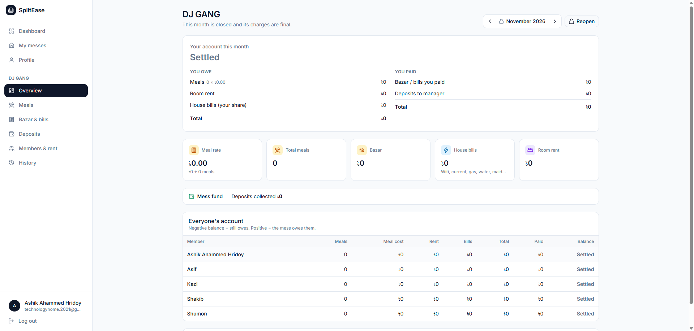

<div align="center">


# SplitEase

**Shared housing expense manager for a "mess": meals, bazar, rent and bills, split fairly every month.**

React · TypeScript · Express · Prisma · MongoDB

</div>



---

## What is this?

In many shared flats, especially student messes in Bangladesh, 4–6 people live together and share the costs:

- they **cook together** and each person eats a different number of meals,
- members **buy groceries (bazar) in turns** from their own pocket,
- **rooms have different rents**,
- **wifi, electricity, gas, water and the maid** are shared,
- one person, the **manager**, keeps the account and collects money.

Usually this lives in a notebook, and the end-of-month calculation causes arguments. SplitEase keeps every meal, bazar, bill and payment in one place. It calculates the meal rate and every member's bill automatically, and shows everyone exactly what they owe or will get back.

## Features

- **Live monthly account.** Meal rate, totals and every member's balance update as soon as something is entered.
- **Fair calculation.** Bazar is split by meals eaten. House bills are split separately. Rent is per person.
- **Different room rents.** Set each member's own monthly rent.
- **Fast meal entry.** A daily view with +/− buttons and "everyone 2 meals" shortcuts, plus a full members × days month sheet. Half meals are supported.
- **Bazar and house bills.** Record who paid each one. Out-of-pocket payments are credited to that member, and bills can be split equally or unequally.
- **Deposits.** Record cash, bKash, Nagad, Rocket or bank payments, and see who still owes at a glance.
- **Close and reopen months.** Closing freezes the charges and locks the month. Members can still pay off a closed month.
- **History.** Every closed month, with your own bill and balance.
- **Invitations.** Invite by email or share an invite link on WhatsApp. Links expire after 7 days.
- **Roles.** Managers edit, members view. The manager role can be handed over.
- **Mobile first.** A bottom tab bar on phones and readable cards instead of wide tables.
- **Secure auth.** JWT access and refresh tokens in httpOnly cookies, plus password reset by email.

## How the bill is calculated

```text
meal rate    = total bazar ÷ total meals
your bill    = your meals × meal rate
             + your room rent
             + your share of house bills
you paid     = bazar/bills you paid yourself + money you gave the manager
balance      = you paid − your bill     (negative = you owe, positive = you get back)
```

**Example:** 5 members, ৳4,000 bazar, 100 meals, so the meal rate is **৳40**. Rahim ate 20 meals (৳800), has a ৳4,000 room and pays a ৳1,200 share of ৳6,000 in bills, so his bill is **৳6,000**. He bought ৳1,500 of bazar and gave the manager ৳3,000, so he **still owes ৳1,500**.

The full rules are in the [PRD](docs/PRD.md#10-business-rules). The code is in [`server/src/utils/billing.js`](server/src/utils/billing.js), with unit tests in [`billing.test.js`](server/src/tests/billing.test.js).

## Tech stack

| Part | Technology |
| --- | --- |
| Client | React 19, TypeScript, Vite, React Router, TanStack Query, Zustand |
| UI | Tailwind CSS 4, shadcn/ui (Base UI), lucide-react |
| Server | Node.js, Express 5, Zod validation |
| Database | MongoDB (Atlas) with Prisma ORM |
| Auth | JWT (access + refresh), bcrypt, httpOnly cookies |
| Email | Nodemailer (SMTP) |
| Tests | Vitest, Supertest |

## Project structure

```text
.
├── client/                 React + TypeScript single-page app
│   ├── public/             favicon
│   └── src/
│       ├── pages/          one file per screen (Overview, Meals, Expenses, Deposits, Members, History…)
│       ├── features/       data hooks (TanStack Query) per feature
│       ├── services/       API calls (axios)
│       ├── components/     shared UI and layout
│       ├── layouts/        app shell and mess shell (bottom tab bar on phones)
│       ├── lib/            currency, month helpers, axios instance
│       └── routes/         router setup
├── server/                 Express API
│   ├── prisma/             schema.prisma (data model)
│   ├── scripts/            one-time data migration
│   └── src/
│       ├── routes/         URL → middleware → controller
│       ├── validations/    Zod schemas for bodies, queries and params
│       ├── controllers/    HTTP layer
│       ├── services/       business logic and database access
│       ├── utils/          billing calculation, dates, membership checks, email
│       └── tests/          unit + integration tests
└── docs/
    ├── PRD.md              product requirements
    └── screenshots/        images used in this README
```

## Getting started

### Prerequisites

- Node.js 20 or newer
- A MongoDB database that supports transactions (a free [MongoDB Atlas](https://www.mongodb.com/atlas) cluster works)
- An SMTP account for password-reset and invitation emails (optional for local development)

### 1. Clone and install

```bash
git clone https://github.com/ahammedhridoy/Shared-Housing-Expense-Management-System.git
cd Shared-Housing-Expense-Management-System

cd server && npm install
cd ../client && npm install
```

### 2. Configure the server

Copy `server/.env.example` to `server/.env` and fill it in:

| Variable | Description |
| --- | --- |
| `PORT` | API port, default `5001` |
| `DATABASE_URL` | MongoDB connection string, including the database name |
| `JWT_ACCESS_SECRET`, `JWT_REFRESH_SECRET` | Two long random strings |
| `JWT_ACCESS_EXPIRES_IN`, `JWT_REFRESH_EXPIRES_IN` | e.g. `15m` and `7d` |
| `CLIENT_URL` | Where the client runs, used for CORS and email links (`http://localhost:5173` locally) |
| `SMTP_HOST`, `SMTP_PORT`, `SMTP_SECURE`, `SMTP_USER`, `SMTP_PASS`, `SMTP_FROM` | Email settings |

Then create the collections and indexes:

```bash
cd server
npm run push
```

> **Upgrading a database from the old version?** Run `npm run migrate:v2` **before** `npm run push`. See [server/README.md](server/README.md#upgrading-an-existing-database).

### 3. Configure the client

Copy `client/.env.example` to `client/.env`:

| Variable | Description |
| --- | --- |
| `VITE_API_URL` | API base URL, e.g. `http://localhost:5001/api/v1` |
| `VITE_CURRENCY_CODE` | e.g. `BDT` or `USD` |
| `VITE_CURRENCY_SYMBOL` | e.g. `৳` or `$` |
| `VITE_CURRENCY_LOCALE` | e.g. `en-BD` or `en-US` |

### 4. Run

In two terminals:

```bash
cd server && npm run dev     # API on http://localhost:5001
cd client && npm run dev     # app on http://localhost:5173
```

Open http://localhost:5173, create an account, create a mess, and invite your flatmates.

## Using the app

1. **Create a mess.** You become its manager. Enter your own room rent.
2. **Invite members** from *Members & rent*. They get an email, or you can copy the invite link and send it on WhatsApp.
3. **Set everyone's room rent** on the same page.
4. **Enter meals every day** on *Meals*, using *Daily entry*, or fix any day on the *Month sheet*.
5. **Add bazar and house bills** on *Bazar & bills*, choosing who paid.
6. **Record deposits** when someone gives you money. *Deposits* shows who still owes.
7. **Check the Overview** at any time. At the end of the month, **Close month** to lock it.

## Scripts

| Where | Command | What it does |
| --- | --- | --- |
| server | `npm run dev` | Start the API with auto-reload |
| server | `npm start` | Start the API |
| server | `npm run push` | Sync the Prisma schema and indexes to the database |
| server | `npm run generate` | Regenerate the Prisma client |
| server | `npm run migrate:v2` | One-time migration from the old data model |
| server | `npm test` | Run all tests |
| client | `npm run dev` | Start the Vite dev server |
| client | `npm run build` | Type-check and build for production |
| client | `npm run lint` | Run ESLint |

## Testing

```bash
cd server
npx vitest run src/tests/billing.test.js   # calculation only, no database needed
npm test                                   # everything, needs DATABASE_URL
```

The integration tests create and delete their own users and messes. Point `DATABASE_URL` at a **separate test database** (for example, the same cluster with a `-test` database name), not your real data.

## API

All endpoints are under `/api/v1` and use cookie authentication. Main groups:

| Group | Base path |
| --- | --- |
| Auth | `/auth` (register, login, me, refresh, logout, forgot/reset password) |
| Mess and members | `/mess`, `/mess/:messId/members` |
| Invitations | `/invitations` |
| Meals | `/mess/:messId/meals` |
| Bazar and bills | `/mess/:messId/expenses` |
| Deposits | `/mess/:messId/deposits` |
| Monthly account | `/mess/:messId/months/:year/:month` (+ `/close`, `/reopen`) |

See [server/README.md](server/README.md#api-all-under-apiv1-cookie-auth) for details, and the [PRD](docs/PRD.md) for the full requirements.

## Roadmap

- Members can request meals on or off for tomorrow
- Carry unpaid balances into the next month
- Export a month to PDF or Excel
- Activity log of every change
- Bengali language option

## Author

Built by [@ahammedhridoy](https://github.com/ahammedhridoy).
